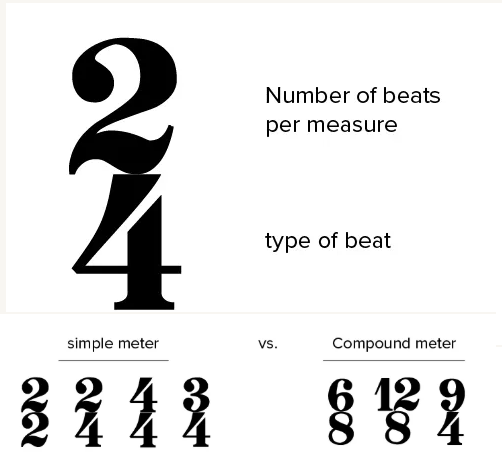

# R_shiny_timesignatures
R_shiny_timesignatures

(find the inspiration pages in emails)

https://shiny.posit.co/

https://github.com/rstudio/shiny < examine a repo

+https://academy.posit.co/page/all-courses

